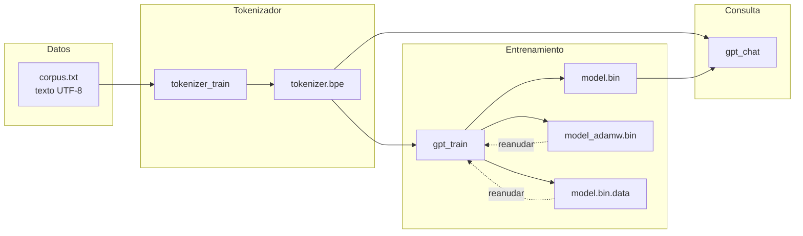
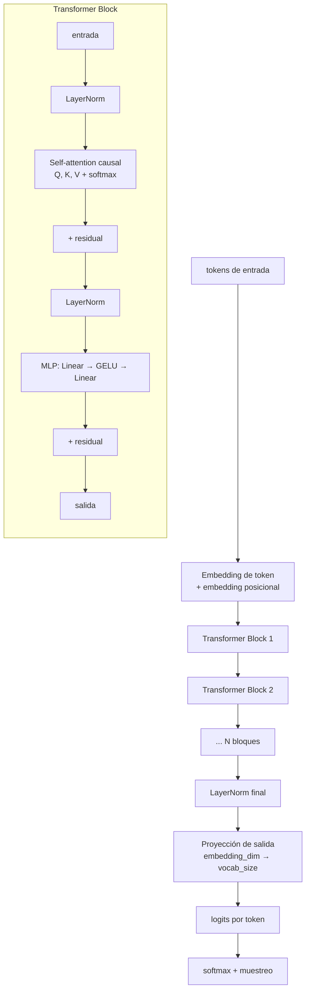
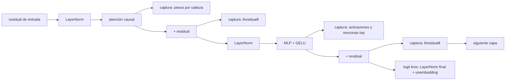

# mini GPT en Rust

[](https://github.com/aratan/MyGPT/actions/workflows/ci.yml)

[](https://www.rust-lang.org/)
[](https://developer.nvidia.com/cuda-toolkit)
[](https://www.nvidia.com/geforce/graphics-cards/40-series/rtx-4060-4060ti/)

Mini GPT escrito desde cero en Rust para aprender cómo funcionan un
transformer, el tokenizador BPE y el entrenamiento. Incluye la librería, cuatro
herramientas de CLI (`synth_data`, `tokenizer_train`, `gpt_train`, `gpt_chat`)
y un visor de interpretabilidad.

**Estado de tecnologías:** Rust está implementado. CUDA dispone de backend experimental con tensores FP32 residentes, operaciones cuBLAS/NVRTC, atención multi-cabeza, `CudaTransformerBlock` y `CudaGPT::forward`. La generación autoregresiva CUDA está propuesta en la PR #17. Todavía no existe validación física confirmada en la RTX 4060. Seguimiento en [la issue #2](https://github.com/aratan/MyGPT/issues/2).

El código de aplicación y las herramientas están escritos en Rust. El backend CUDA
carga dinámicamente el Driver API, NVRTC y cuBLAS, y compila kernels CUDA C en
runtime: no requiere `nvcc`, `build.rs` ni `CMakeLists.txt`. El backend puede
importar los parámetros de un `GPT` CPU a VRAM y ejecutar el forward completo.
La generación autoregresiva aún está en revisión; no se debe confundir la
compilación/CI host con una prueba ejecutada en GPU NVIDIA.

---

## 1. Visión general



`gpt_train` guarda tres artefactos que van juntos:

| Archivo | Contenido |
|---|---|
| `model.bin` | Pesos del modelo (`MINIGPTM`) |
| `model_adamw.bin` | Estado de AdamW (`MINIADAM`) |
| `model.bin.data` | Estado del data loader y metadatos (texto) |

Los formatos binarios son estables y se conservan byte a byte, incluido el
orden de los tensores, para que los checkpoints guardados sigan siendo
legibles entre versiones.

## 2. Arquitectura del modelo



## 3. Ciclo de entrenamiento

```mermaid
sequenceDiagram
    autonumber
    participant CLI as gpt_train
    participant DL as DataLoader
    participant M as GPT
    participant BP as Backprop
    participant OPT as AdamW
    participant CK as Checkpoints

    CLI->>DL: next_batch()
    DL-->>CLI: inputs, targets, mask
    CLI->>M: forward(inputs)
    M-->>CLI: logits
    CLI->>CLI: cross_entropy(logits, targets, mask)
    CLI->>BP: backward()
    BP-->>M: gradientes
    CLI->>BP: clip_gradients(norma global)
    CLI->>OPT: step(model)
    OPT-->>M: pesos actualizados
    alt cada eval_every
        CLI->>M: evaluar subset de validación
    end
    alt cada save_every
        CLI->>CK: model.bin + adamw.bin + .data
    end
```

El data loader divide el corpus en entrenamiento/validación, muestrea
secuencias de `context_length` tokens y conserva su estado para que reanudar
produzca exactamente la misma secuencia de batches.

## 4. Consulta (inferencia)

```mermaid
flowchart TD
    P[prompt] --> MODE{modo}
    MODE -->|completion| RAW[tokenizar el texto tal cual]
    MODE -->|chat| TPL["plantilla de chat: user + prompt + assistant"]
    RAW --> F[forward con contexto]
    TPL --> F
    F --> L[logits del último token]
    L --> ADJ{ajustes}
    ADJ --> TEMP[temperature]
    ADJ --> TOPK[top-k]
    ADJ --> REP[repetition penalty]
    TEMP --> PICK{estrategia}
    TOPK --> PICK
    REP --> PICK
    PICK -->|greedy| ARGMAX[argmax]
    PICK -->|sampling| SAMPLE[muestreo multinomial]
    ARGMAX --> NEXT[siguiente token]
    SAMPLE --> NEXT
    NEXT --> STOP{¿<|eot|> o límite?}
    STOP -->|no| F
    STOP -->|sí| OUT[detokenizar y mostrar]
```

En modo `chat` se detiene al generar `<|eot|>`; en `completion` no se añaden
tokens especiales. `--show-top N` muestra las N predicciones más probables del
primer paso, con los logits originales o ajustados (`--show-adjusted`).

---

## 5. Requisitos

**CPU (funcionamiento completo actual)**

- Rust estable reciente (`cargo`, `rustc`).

**CUDA (inferencia experimental)**

- GPU NVIDIA compatible con CUDA; objetivo de validación: RTX 4060 de 8 GB (compute capability 8.9).
- Driver NVIDIA y bibliotecas CUDA Driver API, NVRTC y cuBLAS disponibles en runtime.
- La CI estándar usa `ubuntu-latest` sin GPU garantizada: comprueba compilación, Clippy y tests host; no demuestra ejecución CUDA física.
- La inferencia CPU sigue disponible como referencia y fallback.
- La generación CUDA inicial (PR #17) descarga logits para sampling host y recalcula el contexto completo en cada paso. KV cache y sampling residente en GPU siguen pendientes.

## 6. Compilación

```bash
cargo build --release
cargo test
```

Los cuatro binarios quedan en `target/release/`:

```
target/release/synth_data
target/release/tokenizer_train
target/release/gpt_train
target/release/gpt_chat
```

Para desarrollo también puedes usar `cargo run --release --bin <nombre> -- <args>`.

## 7. Uso paso a paso

### 7.1 Generar datos sintéticos

Incluye un generador de conversaciones en español (13 categorías: saludos,
capitales, aritmética, animales, colores, conteo, paridad, traducciones,
letras, tiempo, cortesía, identidad y preguntas sin respuesta):

```bash
./target/release/synth_data \
  --output data/synthetic.txt \
  --count 2000 --seed 42
```

- `--count` es el número de conversaciones; `--seed` hace la generación
  determinista; `--overwrite` permite reemplazar el archivo.
- Cada línea sigue el formato de `gpt_chat`:
  `<|user|> pregunta <|eot|>` / `<|assistant|> respuesta <|eot|>`.
- Con `--seed 42 --count 2000` se obtienen 433 conversaciones únicas y unas
  27 900 palabras.

También puedes usar tu propio corpus: cualquier archivo UTF-8 con el mismo
formato de tokens especiales.

### 7.2 Entrenar el tokenizador BPE

```bash
./target/release/tokenizer_train \
  --corpus data/conversations.txt \
  --vocab-size 512 \
  --output artifacts/tokenizer.bpe \
  --progress-every 100
```

Sustituye `data/conversations.txt` por tu corpus (UTF-8, una conversación o
frase por línea). El vocabulario base tiene 260 tokens y cada merge añade uno.

### 7.3 Entrenar el modelo

Ejemplo pequeño para comprobar que todo funciona:

```bash
./target/release/gpt_train \
  --corpus data/conversations.txt \
  --tokenizer artifacts/tokenizer.bpe \
  --steps 20 --batch-size 2 --context-length 64 \
  --embedding-dim 128 --num-heads 4 --num-layers 2 --mlp-hidden-dim 256 \
  --max-seq-len 64 \
  --output-model artifacts/model.bin \
  --output-optimizer artifacts/model_adamw.bin \
  --output-state artifacts/model.bin.data
```

Configuración mayor (entrenamiento en CPU; tarda más):

```bash
./target/release/gpt_train \
  --corpus data/synthetic.txt \
  --tokenizer artifacts/tokenizer.bpe \
  --steps 2000 --batch-size 8 --context-length 128 \
  --embedding-dim 256 --num-heads 4 --num-layers 4 --mlp-hidden-dim 1024 \
  --max-seq-len 128 --lr 0.0003 \
  --save-every 100 --eval-every 50 --validation-samples 16 \
  --output-model artifacts/model.bin \
  --output-optimizer artifacts/model_adamw.bin \
  --output-state artifacts/model.bin.data
```

Para modelos mayores sube `--embedding-dim`, `--num-layers` o `--batch-size`.
Si el equipo se queda sin memoria, reduce el batch o usa `--grad-accum`.

**Reanudar** (lee corpus, tokenizer y configuración del `.data`):

```bash
./target/release/gpt_train \
  --resume artifacts/model.bin \
  --steps 500 \
  --output-model artifacts/model_next.bin \
  --output-optimizer artifacts/model_next_adamw.bin \
  --output-state artifacts/model_next.data
```

Sin `--overwrite`, nunca se sobrescribe el checkpoint de entrada; se generan
rutas `*_next.*`.

**Acumulación de gradientes** (más batch efectivo sin multiplicar la memoria
de activaciones):

```bash
./target/release/gpt_train ... --batch-size 2 --grad-accum 8
```

Cada paso de optimizador promedia 8 micro-batches de 2 secuencias (batch
efectivo 16). `--steps` cuenta pasos de AdamW, no micro-batches.

### 7.4 Consultas e inferencia

**Continuar texto (completion):**

```bash
./target/release/gpt_chat \
  --model artifacts/model.bin \
  --tokenizer artifacts/tokenizer.bpe \
  --mode completion \
  --prompt "Había una vez" \
  --max-tokens 40 \
  --strategy sampling --temperature 0.8 --top-k 40 \
  --repetition-penalty 1.1
```

**Una pregunta en modo chat:**

```bash
./target/release/gpt_chat \
  --model artifacts/model.bin \
  --tokenizer artifacts/tokenizer.bpe \
  --mode chat \
  --prompt "hola, ¿qué puedes hacer?" \
  --max-tokens 32 \
  --show-top 5
```

**Evaluar una continuación esperada** (no genera; compara con `--expected`):

```bash
./target/release/gpt_chat \
  --model artifacts/model.bin \
  --tokenizer artifacts/tokenizer.bpe \
  --prompt "hola" \
  --expected "hola, ¿en qué puedo ayudarte?"
```

**Modo interactivo** (sin `--prompt`): escribe mensajes y usa `/reset` para
limpiar el contexto o `/exit` para salir.

| Opción | Valores | Defecto |
|---|---|---|
| `--mode` | `chat`, `completion` | `chat` |
| `--strategy` | `greedy`, `sampling` | `greedy` |
| `--temperature` | > 0 | `1.0` |
| `--top-k` | 0 = desactivado | `0` |
| `--repetition-penalty` | ≥ 1 | `1.0` |
| `--max-tokens` | entero | `16` |
| `--seed` | entero | `42` |
| `--show-top` | entero | `0` |

`greedy` es determinista y sirve para comprobar el aprendizaje; `sampling` con
temperatura y top-k produce respuestas más variadas.

---

## 8. Ver cómo piensa el modelo

`gpt_chat` puede capturar la telemetría interna de un prompt y mostrarla en el
terminal o exportarla a un visor HTML interactivo:

```bash
./target/release/gpt_chat \
  --model artifacts/model.bin \
  --tokenizer artifacts/tokenizer.bpe \
  --mode chat --prompt "hola, ¿qué puedes hacer?" \
  --trace --trace-html artifacts/trace.html
```

El HTML es un único archivo autocontenido (sin servidor ni dependencias) que se
abre directamente en el navegador. Incluye selector de capa y cabeza, mapa de
atención con tooltip por token, entropía por cabeza, normas del flujo residual,
neuronas MLP más activas y logit lens.

Para explorar sin salir de la terminal usa `--trace-tui`: muestra el mismo
informe y permite navegar con `n`/`p` (capa siguiente/anterior), `h`/`l`
(cabeza siguiente/anterior), `"capa cabeza"` para saltar a una vista concreta y
`q` para salir.



Qué muestra cada señal:

| Señal | Para qué sirve |
|---|---|
| Pesos de atención | A qué tokens anteriores mira cada cabeza al predecir |
| Norma del residual | Qué capas cambian más el vector y cuáles apenas lo tocan |
| Activaciones MLP | Qué neuronas se disparan tras GELU (conocimiento factual) |
| Logit lens | En qué capa el modelo ya "adivina" la respuesta |

Opciones específicas:

| Opción | Efecto |
|---|---|
| `--trace` | Imprime el informe en el terminal |
| `--trace-tui` | Explorador interactivo de capas y cabezas en el terminal |
| `--trace-html <ruta>` | Escribe el visor HTML autocontenido |
| `--trace-layer <N>` | Capa del mapa de atención en terminal (defecto: última) |
| `--trace-head <N>` | Cabeza del mapa de atención (defecto: 0) |

La traza se calcula con un forward extra solo cuando se pide, requiere lote 1 y
no afecta a la generación normal. El HTML incluye las etiquetas de los tokens
del prompt y de las predicciones del logit lens.

## 9. Guía de los binarios compilados

Tras `cargo build --release`, todos los ejecutables están en `target/release/`:

| Binario | Para qué sirve |
|---|---|
| `synth_data` | Genera un corpus de conversaciones sintéticas |
| `tokenizer_train` | Entrena el vocabulario BPE |
| `gpt_train` | Entrena o reanuda el modelo |
| `gpt_chat` | Consultas, chat interactivo y trazas |

Cada uno muestra su ayuda con `--help`:

```bash
./target/release/synth_data --help
./target/release/tokenizer_train --help
./target/release/gpt_train --help
./target/release/gpt_chat --help
```

También puedes ejecutarlos sin compilar aparte:

```bash
cargo run --release --bin synth_data -- --count 100
```

### 9.1 `synth_data`

Genera conversaciones con el formato exacto de `gpt_chat`:

```bash
./target/release/synth_data \
  --output artifacts/synthetic.txt \
  --count 4000 \
  --seed 42 \
  --overwrite
```

Salida típica:

```
Conversaciones generadas: 4000
Conversaciones únicas: 563
Bytes: 374919
Categorías:
  animales: 317
  ...
Salida: artifacts/synthetic.txt
```

| Opción | Defecto | Descripción |
|---|---|---|
| `--output` | `data/synthetic.txt` | Archivo de salida |
| `--count` | `2000` | Número de conversaciones |
| `--seed` | `42` | Semilla determinista |
| `--overwrite` | desactivado | Permite reemplazar la salida |

### 9.2 `tokenizer_train`

Entrena el BPE byte-level; el vocabulario base es 260 y cada merge añade uno.

```bash
./target/release/tokenizer_train \
  --corpus artifacts/synthetic.txt \
  --vocab-size 512 \
  --output artifacts/tokenizer.bpe \
  --progress-every 100 \
  --overwrite
```

| Opción | Defecto | Descripción |
|---|---|---|
| `--corpus` | obligatorio | Corpus UTF-8 |
| `--vocab-size` | `2048` | Tamaño máximo del vocabulario |
| `--output` | `tokenizer.bpe` | Archivo de salida |
| `--validation-ratio` | `0.1` | Fracción reservada para validación |
| `--progress-every` | `25` | Progreso cada N merges |
| `--overwrite` | desactivado | Permite reemplazar la salida |

### 9.3 `gpt_train`

Entrenamiento desde cero, con evaluación y checkpoints:

```bash
./target/release/gpt_train \
  --corpus artifacts/synthetic.txt \
  --tokenizer artifacts/tokenizer.bpe \
  --steps 200 --batch-size 4 --context-length 64 \
  --embedding-dim 128 --num-heads 4 --num-layers 2 --mlp-hidden-dim 256 \
  --max-seq-len 64 --lr 0.0003 \
  --eval-every 25 --save-every 50 \
  --output-model artifacts/model.bin \
  --output-optimizer artifacts/model_adamw.bin \
  --output-state artifacts/model.bin.data
```

Reanudar leyendo corpus, tokenizer y configuración del `.data`:

```bash
./target/release/gpt_train \
  --resume artifacts/model.bin \
  --steps 200 \
  --output-model artifacts/model_next.bin \
  --output-optimizer artifacts/model_next_adamw.bin \
  --output-state artifacts/model_next.data
```

Batch efectivo grande sin multiplicar la memoria de activaciones:

```bash
./target/release/gpt_train ... --batch-size 2 --grad-accum 8
```

| Opción | Defecto | Descripción |
|---|---|---|
| `--corpus`, `--tokenizer` | obligatorios al empezar | Datos de entrenamiento |
| `--resume` | – | Checkpoint a continuar |
| `--steps` | `20` | Pasos de optimizador |
| `--batch-size` | `2` | Secuencias por micro-batch |
| `--grad-accum` | `1` | Micro-batches por paso |
| `--context-length` | `128` | Tokens por secuencia |
| `--embedding-dim`, `--num-heads`, `--num-layers`, `--mlp-hidden-dim` | `256/4/4/1024` | Arquitectura (solo desde cero) |
| `--max-seq-len` | `128` | Longitud máxima (≤ 256) |
| `--lr`, `--clip`, `--weight-decay` | `0.0003/1.0/0.01` | Optimización |
| `--eval-every`, `--save-every` | `10/50` | Evaluación y checkpoints; `0` desactiva |
| `--overwrite` | desactivado | Permite reemplazar salidas |

### 9.4 `gpt_chat`

Pregunta única en modo chat:

```bash
./target/release/gpt_chat \
  --model artifacts/model.bin \
  --tokenizer artifacts/tokenizer.bpe \
  --mode chat \
  --prompt "¿Cuál es la capital de Francia?" \
  --max-tokens 24 \
  --show-top 3
```

Continuar texto en modo completion:

```bash
./target/release/gpt_chat \
  --model artifacts/model.bin \
  --tokenizer artifacts/tokenizer.bpe \
  --mode completion \
  --prompt "Había una vez" \
  --strategy sampling --temperature 0.8 --top-k 40 \
  --repetition-penalty 1.1 \
  --max-tokens 40
```

Evaluar una respuesta esperada sin generar:

```bash
./target/release/gpt_chat \
  --model artifacts/model.bin \
  --tokenizer artifacts/tokenizer.bpe \
  --prompt "hola" \
  --expected "Hola. ¿En qué puedo ayudarte?"
```

Chat interactivo (sin `--prompt`): escribe mensajes, `/reset` limpia el
contexto y `/exit` termina.

Ver la traza interna en terminal o en HTML:

```bash
./target/release/gpt_chat \
  --model artifacts/model.bin \
  --tokenizer artifacts/tokenizer.bpe \
  --mode chat --prompt "¿Cuál es la capital de Francia?" \
  --trace --trace-html artifacts/trace.html

./target/release/gpt_chat ... --trace-tui
```

| Opción | Defecto | Descripción |
|---|---|---|
| `--model`, `--tokenizer` | obligatorios | Checkpoint y vocabulario |
| `--mode` | `chat` | `chat` o `completion` |
| `--strategy` | `greedy` | `greedy` o `sampling` |
| `--temperature` | `1.0` | Temperatura de muestreo |
| `--top-k` | `0` | Candidatos; `0` desactiva |
| `--repetition-penalty` | `1.0` | Penalización (≥ 1) |
| `--max-tokens` | `16` | Tokens nuevos por turno |
| `--seed` | `42` | Semilla de muestreo |
| `--show-top` | `0` | Muestra las N predicciones |
| `--prompt`, `--expected` | – | Consulta única / evaluación |
| `--trace`, `--trace-tui`, `--trace-html` | desactivado | Interpretabilidad |

### 9.5 Flujo completo copiable

```bash
cargo build --release

./target/release/synth_data \
  --output artifacts/synthetic.txt --count 4000 --seed 42 --overwrite

./target/release/tokenizer_train \
  --corpus artifacts/synthetic.txt --vocab-size 512 \
  --output artifacts/tokenizer.bpe --overwrite

./target/release/gpt_train \
  --corpus artifacts/synthetic.txt --tokenizer artifacts/tokenizer.bpe \
  --steps 300 --batch-size 4 --context-length 64 \
  --embedding-dim 128 --num-heads 4 --num-layers 2 --mlp-hidden-dim 256 \
  --max-seq-len 64 --eval-every 50 --save-every 100 \
  --output-model artifacts/model.bin \
  --output-optimizer artifacts/model_adamw.bin \
  --output-state artifacts/model.bin.data

./target/release/gpt_chat \
  --model artifacts/model.bin --tokenizer artifacts/tokenizer.bpe \
  --mode chat --prompt "¿Cuál es la capital de Francia?" --max-tokens 24
```

### 9.6 Artefactos

| Archivo | Contenido |
|---|---|
| `artifacts/synthetic.txt` | Corpus generado |
| `artifacts/tokenizer.bpe` | Vocabulario BPE (`MINIGPTB`) |
| `artifacts/model.bin` | Pesos (`MINIGPTM`) |
| `artifacts/model_adamw.bin` | Estado de AdamW (`MINIADAM`) |
| `artifacts/model.bin.data` | Estado del data loader y metadatos |
| `artifacts/trace.html` | Visor de interpretabilidad |

`artifacts/`, `*.bin` y `*.bpe` están en `.gitignore`.

### 9.7 Descargar y verificar una release

La release `v0.1.0` incluye los cuatro binarios para Linux x86_64. Se publican
automáticamente al subir un tag `v*` (workflow `Release`).

```bash
curl -LO https://github.com/aratan/MyGPT/releases/download/v0.1.0/mini-gpt-rust-v0.1.0-x86_64-unknown-linux-gnu.tar.gz
curl -LO https://github.com/aratan/MyGPT/releases/download/v0.1.0/SHA256SUMS.txt
sha256sum -c SHA256SUMS.txt
tar -xzf mini-gpt-rust-v0.1.0-x86_64-unknown-linux-gnu.tar.gz
./synth_data --help
```

Si `sha256sum -c` responde `OK`, el paquete coincide con el publicado. Para
otra versión, sustituye `v0.1.0` por su tag en ambas URLs.


## 10. Estructura del proyecto

```text
.
├── examples/
│   └── matmul_bench.rs   # benchmark de matmul en CPU
├── src/
│   ├── tensor.rs         # tensor, matmul paralela en CPU, linear
│   ├── tokenizer.rs      # BPE byte-level, formato MINIGPTB
│   ├── embedding.rs      # embeddings de token y posición
│   ├── attention.rs      # self-attention causal
│   ├── transformer.rs    # bloque transformer + LayerNorm
│   ├── gpt.rs            # modelo, forward, generación, checkpoints
│   ├── loss.rs           # cross-entropy con máscara
│   ├── backprop.rs       # retropropagación de todas las capas
│   ├── adamw.rs          # AdamW + recorte de gradientes
│   ├── data.rs           # corpus, batches, estado del muestreo
│   ├── training_state.rs # metadatos y reanudación
│   ├── inference.rs      # softmax, muestreo, evaluación de expected
│   ├── trace.rs          # trazas: atención, residual, MLP, logit lens y HTML
│   ├── synthetic.rs      # generador de conversaciones sintéticas
│   └── bin/              # synth_data, tokenizer_train, gpt_train, gpt_chat
└── tests/core.rs         # tests de todas las piezas
```

## 11. Tests y verificación

```bash
cargo test
cargo build --release
```

Se comprobó además:

- Flujo completo tokenizer → entrenamiento → reanudación → chat.
- Carga y guardado de checkpoints con los formatos binarios documentados.
- Entrenamiento de extremo a extremo con el corpus sintético generado.

## 12. Limitaciones

- El backend CUDA experimental ofrece operaciones FP32 residentes en VRAM
  (embeddings, linear/cuBLAS, bias, embeddings posicionales, elementwise,
  softmax, LayerNorm y GELU). Aún no está conectado a `GPT::forward`,
  `gpt_train` ni `gpt_chat`; por tanto, el modelo completo sigue ejecutándose
  en CPU. La CI no sustituye la validación en una GPU NVIDIA física.
- No hay precisión mixta (fp16/bf16). La acumulación de gradientes sí está
  disponible (`--grad-accum`) para aumentar el batch efectivo sin multiplicar
  la memoria de activaciones.
- El RNG de inicialización es `xoshiro256**`, determinista para una semilla
  dada.
- GELU usa una aproximación de `erf` (~1e-7 de error).
- No se incluyen las demos antiguas ni una segunda implementación del modelo:
  la lógica de aplicación permanece en Rust y CUDA se limita a kernels del backend.
- `gpt_train` no captura Ctrl+C; usa `--save-every` para checkpoints
  periódicos.

## 13. Licencia

Distribuido bajo la licencia MIT. Consulta [LICENSE](LICENSE).
