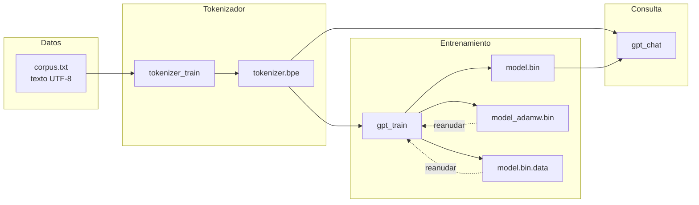
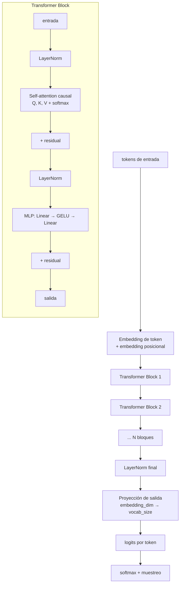
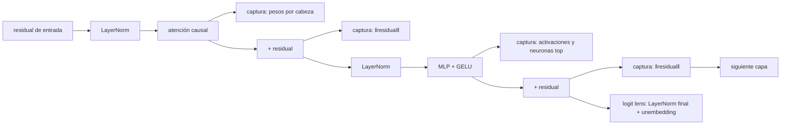

# mini GPT en Rust + CUDA

Mini GPT escrito desde cero en Rust para aprender cómo funcionan un
transformer, el tokenizador BPE y el entrenamiento. Incluye la librería, las
tres herramientas de CLI (`tokenizer_train`, `gpt_train`, `gpt_chat`), un visor
de interpretabilidad y un **backend CUDA opcional** para entrenar en una GPU
(probado en una RTX 4060).

Todo el proyecto es Rust: no hay código C++ de aplicación, ni `.cpp`, `.hpp`
ni `CMakeLists.txt`. La única pieza compilada fuera de Rust es
`cuda/kernels.cu`, el código de dispositivo que `nvcc` necesita para usar
cuBLAS; sin la feature `cuda` ni siquiera se compila.

---

## 1. Visión general



`gpt_train` guarda tres artefactos que van juntos:

| Archivo | Contenido |
|---|---|
| `model.bin` | Pesos del modelo (`MINIGPTM`) |
| `model_adamw.bin` | Estado de AdamW (`MINIADAM`) |
| `model.bin.data` | Estado del data loader y metadatos (texto) |

Los formatos binarios son estables y se conservan byte a byte, incluido el
orden de los tensores, para que los checkpoints guardados sigan siendo
legibles entre versiones.

## 2. Arquitectura del modelo



## 3. Ciclo de entrenamiento

```mermaid
sequenceDiagram
    autonumber
    participant CLI as gpt_train
    participant DL as DataLoader
    participant M as GPT
    participant BP as Backprop
    participant OPT as AdamW
    participant CK as Checkpoints

    CLI->>DL: next_batch()
    DL-->>CLI: inputs, targets, mask
    CLI->>M: forward(inputs)
    M-->>CLI: logits
    CLI->>CLI: cross_entropy(logits, targets, mask)
    CLI->>BP: backward()
    BP-->>M: gradientes
    CLI->>BP: clip_gradients(norma global)
    CLI->>OPT: step(model)
    OPT-->>M: pesos actualizados
    alt cada eval_every
        CLI->>M: evaluar subset de validación
    end
    alt cada save_every
        CLI->>CK: model.bin + adamw.bin + .data
    end
```

El data loader divide el corpus en entrenamiento/validación, muestrea
secuencias de `context_length` tokens y conserva su estado para que reanudar
produzca exactamente la misma secuencia de batches.

## 4. Consulta (inferencia)

```mermaid
flowchart TD
    P[prompt] --> MODE{modo}
    MODE -->|completion| RAW[tokenizar el texto tal cual]
    MODE -->|chat| TPL["plantilla de chat: user + prompt + assistant"]
    RAW --> F[forward con contexto]
    TPL --> F
    F --> L[logits del último token]
    L --> ADJ{ajustes}
    ADJ --> TEMP[temperature]
    ADJ --> TOPK[top-k]
    ADJ --> REP[repetition penalty]
    TEMP --> PICK{estrategia}
    TOPK --> PICK
    REP --> PICK
    PICK -->|greedy| ARGMAX[argmax]
    PICK -->|sampling| SAMPLE[muestreo multinomial]
    ARGMAX --> NEXT[siguiente token]
    SAMPLE --> NEXT
    NEXT --> STOP{¿<|eot|> o límite?}
    STOP -->|no| F
    STOP -->|sí| OUT[detokenizar y mostrar]
```

En modo `chat` se detiene al generar `<|eot|>`; en `completion` no se añaden
tokens especiales. `--show-top N` muestra las N predicciones más probables del
primer paso, con los logits originales o ajustados (`--show-adjusted`).

---

## 5. Requisitos

**Solo CPU**

- Rust estable reciente (`cargo`, `rustc`). El crate no usa dependencias
  externas.

**CUDA (opcional)**

- GPU NVIDIA (probado en RTX 4060 Laptop, 8 GB, compute capability 8.9).
- Driver NVIDIA y CUDA Toolkit con `nvcc` (probado con CUDA 13.5).
- `cuBLAS` y `cudart`, que vienen con el toolkit.

## 6. Compilación

```bash
# CPU
cargo build --release

# GPU (RTX 4060)
cargo build --release --features cuda

# Tests
cargo test
cargo test --features cuda
```

El `build.rs` localiza `nvcc` en `NVCC`, `/opt/cuda/bin/nvcc`,
`/usr/local/cuda/bin/nvcc` o el `PATH`, detecta la compute capability con
`nvidia-smi` (si falla usa `sm_89`) y enlaza `cuda/kernels.cu` con cuBLAS.

Variables útiles:

| Variable | Efecto |
|---|---|
| `NVCC` | Ruta a `nvcc` |
| `CUDA_LIB_DIR` | Directorio con `libcublas.so` / `libcudart.so` |
| `MINI_GPT_CUDA_ARCH` | Arquitectura, p. ej. `sm_89` |
| `MINI_GPT_DEVICE=cpu` | Fuerza CPU con un binario compilado con CUDA |

Los binarios quedan en `target/release/`. Al entrenar, la primera línea
indica el backend activo:

```
Backend: CUDA (NVIDIA GeForce RTX 4060 Laptop GPU)
```

## 7. Uso paso a paso

### 7.1 Entrenar el tokenizador BPE

```bash
./target/release/tokenizer_train \
  --corpus data/conversations.txt \
  --vocab-size 512 \
  --output artifacts/tokenizer.bpe \
  --progress-every 100
```

Sustituye `data/conversations.txt` por tu corpus (UTF-8, una conversación o
frase por línea). El vocabulario base tiene 260 tokens y cada merge añade uno.

### 7.2 Entrenar el modelo

Ejemplo pequeño para comprobar que todo funciona:

```bash
./target/release/gpt_train \
  --corpus data/conversations.txt \
  --tokenizer artifacts/tokenizer.bpe \
  --steps 20 --batch-size 2 --context-length 64 \
  --embedding-dim 128 --num-heads 4 --num-layers 2 --mlp-hidden-dim 256 \
  --max-seq-len 64 \
  --output-model artifacts/model.bin \
  --output-optimizer artifacts/model_adamw.bin \
  --output-state artifacts/model.bin.data
```

Configuración razonable para una RTX 4060 de 8 GB:

```bash
./target/release/gpt_train \
  --corpus data/conversations.txt \
  --tokenizer artifacts/tokenizer.bpe \
  --steps 2000 --batch-size 8 --context-length 128 \
  --embedding-dim 384 --num-heads 6 --num-layers 6 --mlp-hidden-dim 1536 \
  --max-seq-len 128 --lr 0.0003 \
  --save-every 100 --eval-every 50 --validation-samples 16 \
  --output-model artifacts/model.bin \
  --output-optimizer artifacts/model_adamw.bin \
  --output-state artifacts/model.bin.data
```

Con ~11 M de parámetros, pesos + gradientes + estado de AdamW ocupan unos
pocos cientos de MB, así que cabe de sobra en 8 GB. Para modelos mayores sube
`--embedding-dim`, `--num-layers` o `--batch-size`; si aparece un error de
memoria de CUDA, reduce primero el batch.

**Reanudar** (lee corpus, tokenizer y configuración del `.data`):

```bash
./target/release/gpt_train \
  --resume artifacts/model.bin \
  --steps 500 \
  --output-model artifacts/model_next.bin \
  --output-optimizer artifacts/model_next_adamw.bin \
  --output-state artifacts/model_next.data
```

Sin `--overwrite`, nunca se sobrescribe el checkpoint de entrada; se generan
rutas `*_next.*`.

**Acumulación de gradientes** (más batch efectivo sin multiplicar la memoria
de activaciones):

```bash
./target/release/gpt_train ... --batch-size 2 --grad-accum 8
```

Cada paso de optimizador promedia 8 micro-batches de 2 secuencias (batch
efectivo 16). `--steps` cuenta pasos de AdamW, no micro-batches.

### 7.3 Consultas e inferencia

**Continuar texto (completion):**

```bash
./target/release/gpt_chat \
  --model artifacts/model.bin \
  --tokenizer artifacts/tokenizer.bpe \
  --mode completion \
  --prompt "Había una vez" \
  --max-tokens 40 \
  --strategy sampling --temperature 0.8 --top-k 40 \
  --repetition-penalty 1.1
```

**Una pregunta en modo chat:**

```bash
./target/release/gpt_chat \
  --model artifacts/model.bin \
  --tokenizer artifacts/tokenizer.bpe \
  --mode chat \
  --prompt "hola, ¿qué puedes hacer?" \
  --max-tokens 32 \
  --show-top 5
```

**Evaluar una continuación esperada** (no genera; compara con `--expected`):

```bash
./target/release/gpt_chat \
  --model artifacts/model.bin \
  --tokenizer artifacts/tokenizer.bpe \
  --prompt "hola" \
  --expected "hola, ¿en qué puedo ayudarte?"
```

**Modo interactivo** (sin `--prompt`): escribe mensajes y usa `/reset` para
limpiar el contexto o `/exit` para salir.

| Opción | Valores | Defecto |
|---|---|---|
| `--mode` | `chat`, `completion` | `chat` |
| `--strategy` | `greedy`, `sampling` | `greedy` |
| `--temperature` | > 0 | `1.0` |
| `--top-k` | 0 = desactivado | `0` |
| `--repetition-penalty` | ≥ 1 | `1.0` |
| `--max-tokens` | entero | `16` |
| `--seed` | entero | `42` |
| `--show-top` | entero | `0` |

`greedy` es determinista y sirve para comprobar el aprendizaje; `sampling` con
temperatura y top-k produce respuestas más variadas.

---

## 8. Ver cómo piensa el modelo

`gpt_chat` puede capturar la telemetría interna de un prompt y mostrarla en el
terminal o exportarla a un visor HTML interactivo:

```bash
./target/release/gpt_chat \
  --model artifacts/model.bin \
  --tokenizer artifacts/tokenizer.bpe \
  --mode chat --prompt "hola, ¿qué puedes hacer?" \
  --trace --trace-html artifacts/trace.html
```

El HTML es un único archivo autocontenido (sin servidor ni dependencias) que se
abre directamente en el navegador. Incluye selector de capa y cabeza, mapa de
atención con tooltip por token, entropía por cabeza, normas del flujo residual,
neuronas MLP más activas y logit lens.

Para explorar sin salir de la terminal usa `--trace-tui`: muestra el mismo
informe y permite navegar con `n`/`p` (capa siguiente/anterior), `h`/`l`
(cabeza siguiente/anterior), `"capa cabeza"` para saltar a una vista concreta y
`q` para salir.



Qué muestra cada señal:

| Señal | Para qué sirve |
|---|---|
| Pesos de atención | A qué tokens anteriores mira cada cabeza al predecir |
| Norma del residual | Qué capas cambian más el vector y cuáles apenas lo tocan |
| Activaciones MLP | Qué neuronas se disparan tras GELU (conocimiento factual) |
| Logit lens | En qué capa el modelo ya "adivina" la respuesta |

Opciones específicas:

| Opción | Efecto |
|---|---|
| `--trace` | Imprime el informe en el terminal |
| `--trace-tui` | Explorador interactivo de capas y cabezas en el terminal |
| `--trace-html <ruta>` | Escribe el visor HTML autocontenido |
| `--trace-layer <N>` | Capa del mapa de atención en terminal (defecto: última) |
| `--trace-head <N>` | Cabeza del mapa de atención (defecto: 0) |

La traza se calcula con un forward extra solo cuando se pide, requiere lote 1 y
no afecta a la generación normal. El HTML incluye las etiquetas de los tokens
del prompt y de las predicciones del logit lens.

## 9. CUDA en la RTX 4060

### Qué se acelera

Con `--features cuda`, las **matmuls y proyecciones lineales** (atención,
MLP, proyección de salida) y su **retropropagación** se ejecutan con cuBLAS en
la GPU. El resto —softmax de atención, LayerNorm, GELU, AdamW y el data
loader— sigue en CPU.

Las matrices se copian host → GPU → host en cada llamada y los buffers de
dispositivo se reutilizan. Por eso la GPU se usa solo cuando el trabajo supera
un umbral (`m·k·n ≥ 2²⁰`); las operaciones pequeñas se quedan en CPU, donde no
compensa el tráfico PCIe.

### Medidas reales en esta máquina

RTX 4060 Laptop 8 GB, CUDA 13.5, mismo binario con `MINI_GPT_DEVICE=cpu|cuda`:

| Prueba | CPU | CUDA | Aceleración |
|---|---|---|---|
| Matmul 512×512×512 | 71,5 GFLOP/s | 276,3 GFLOP/s | 3,9× |
| Matmul 1024×1024×1024 | 111,9 GFLOP/s | 945,8 GFLOP/s | 8,5× |
| Entrenamiento, 1,23 M parámetros, 5 pasos | 4,76 s | 0,96 s | 4,9× |

La loss fue idéntica en ambos casos (`5.210534`), lo que confirma que la ruta
CUDA calcula lo mismo que la CPU. Reproduce el benchmark con:

```bash
cargo run --release --features cuda --example matmul_bench -- 1024 20
MINI_GPT_DEVICE=cpu cargo run --release --features cuda --example matmul_bench -- 1024 20
```

Los números dependen de la GPU, la versión de CUDA y la carga de la máquina.

### Qué esperar

- Modelos pequeños (dim 128, secuencias cortas) apenas notan la GPU: muchas
  operaciones caen por debajo del umbral.
- A partir de dim 256, batch × contexto ≥ 256 y varias capas, la diferencia
  es clara (la medición de entrenamiento usó dim 256, 2 capas, batch 4,
  contexto 64).
- Si compilas sin `--features cuda`, todo funciona en CPU sin cambios.

---

## 10. Estructura del proyecto

```text
.
├── build.rs              # compila y enlaza el backend CUDA (feature `cuda`)
├── cuda/kernels.cu       # matmul con cuBLAS y buffers de dispositivo
├── examples/
│   └── matmul_bench.rs   # benchmark CPU vs CUDA
├── src/
│   ├── tensor.rs         # tensor, matmul (CPU paralela / CUDA), linear
│   ├── tokenizer.rs      # BPE byte-level, formato MINIGPTB
│   ├── embedding.rs      # embeddings de token y posición
│   ├── attention.rs      # self-attention causal
│   ├── transformer.rs    # bloque transformer + LayerNorm
│   ├── gpt.rs            # modelo, forward, generación, checkpoints
│   ├── loss.rs           # cross-entropy con máscara
│   ├── backprop.rs       # retropropagación de todas las capas
│   ├── adamw.rs          # AdamW + recorte de gradientes
│   ├── data.rs           # corpus, batches, estado del muestreo
│   ├── training_state.rs # metadatos y reanudación
│   ├── inference.rs      # softmax, muestreo, evaluación de expected
│   ├── trace.rs          # trazas: atención, residual, MLP, logit lens y HTML
│   ├── cuda.rs           # detección de backend y FFI seguro
│   └── bin/              # tokenizer_train, gpt_train, gpt_chat
└── tests/core.rs         # tests de todas las piezas
```

## 11. Tests y verificación

```bash
cargo test                    # CPU
cargo test --features cuda    # incluye contraste CUDA vs CPU
cargo build --release
cargo build --release --features cuda
```

Se comprobó además:

- Flujo completo tokenizer → entrenamiento → reanudación → chat.
- Carga y guardado de checkpoints con los formatos binarios documentados.
- Misma loss en CPU y CUDA para la misma semilla y datos.

## 12. Limitaciones

- El backend CUDA copia datos en cada operación; no mantiene pesos ni
  activaciones residentes en la GPU. La atención, LayerNorm, GELU y AdamW
  siguen en CPU, así que cada matmul paga copias PCIe. Es una primera
  integración correcta y útil, no un framework de alto rendimiento.
- En consecuencia, pedir más kernels sueltos (atención, LayerNorm, GELU) no
  aportaría velocidad sin el rediseño de residencia en GPU.
- No hay precisión mixta (fp16/bf16) ni multi-GPU. La acumulación de
  gradientes sí está disponible (`--grad-accum`) para aumentar el batch
  efectivo sin multiplicar la memoria de activaciones.
- Compilar con CUDA requiere el toolkit en la máquina de compilación.
- El RNG de inicialización es `xoshiro256**`, determinista para una semilla
  dada.
- GELU usa una aproximación de `erf` (~1e-7 de error).
- No se incluyen las demos antiguas ni una segunda implementación nativa:
  todo el código de aplicación es Rust.
- `gpt_train` no captura Ctrl+C; usa `--save-every` para checkpoints
  periódicos.
